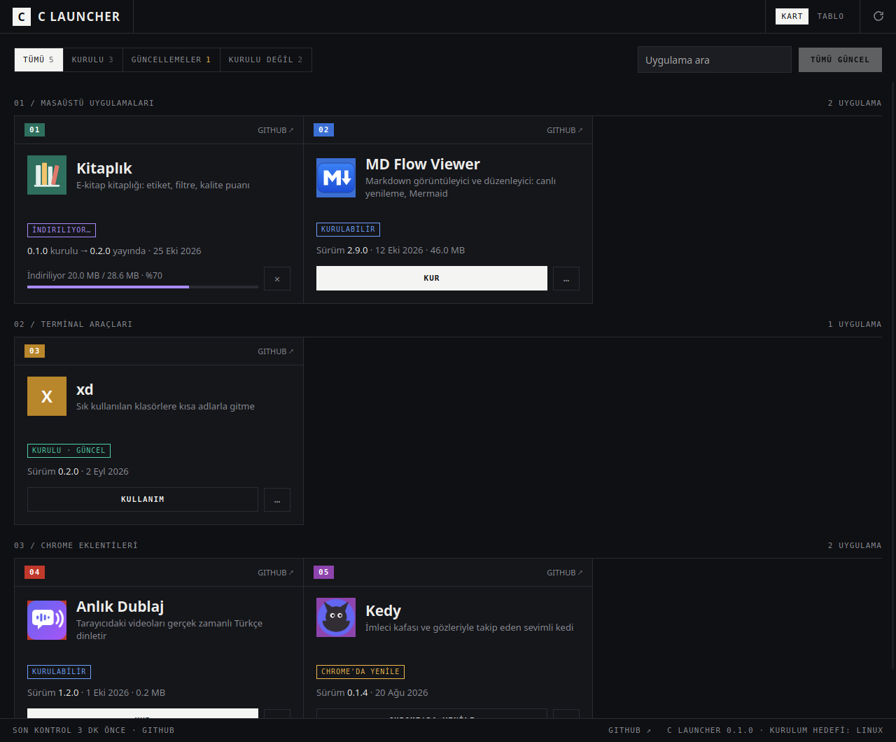

# C Launcher

**cafercan'ın uygulamalarını tek yerden kuran, güncelleyen ve açan küçük bir masaüstü uygulaması.**
Windows, macOS ve Linux'ta çalışır.

*A small desktop launcher that installs, updates and opens cafercan's apps (desktop apps, terminal
tools and Chrome extensions) straight from their GitHub releases. Windows, macOS and Linux.*



## Ne yapar

- **Tek liste:** masaüstü uygulamaları, terminal araçları ve Chrome eklentileri gruplar hâlinde
- **Durum bir bakışta:** kurulu mu, güncel mi, güncelleme var mı, bu sistem için sunuluyor mu
- **Tek tıkla kur ve güncelle:** işletim sisteminize uygun dosyayı GitHub release'inden indirir,
  `SHA256SUMS.txt` ile doğrular ve kurar. Güncellemeler aynı yere kurulur; varsayılan uygulama
  ayarlarınız korunur
- **Elle kurduklarınızı da bulur:** kurulu sürümü sistemin kendisinden okur (Windows kayıt
  defteri, macOS `Info.plist`, Linux `dpkg`)
- **Kart ve tablo görünümü,** arama, filtre, "Tümünü güncelle"
- Açık ve koyu tema sistemi izler

## İndirme

[Son sürüm](https://github.com/cafercan/c-launcher/releases/latest):

| Sistem | Dosya |
|---|---|
| Windows 10/11 | `C.Launcher_<sürüm>_x64-setup.exe`: yönetici izni istemez |
| macOS 11+ | `C.Launcher_<sürüm>_universal.dmg`: Apple silicon ve Intel |
| Linux | `.deb` (Ubuntu, Debian, Mint) ya da `.AppImage` (diğerleri) |

> macOS sürümü Apple tarafından imzalı değil. İlk açılışta "geliştirici doğrulanamadı" uyarısı
> çıkarsa uygulamaya sağ tıklayıp **Aç**'ı seçin.

## Uygulama eklemek

Listedeki uygulamalar [`catalog.json`](catalog.json) dosyasından gelir ve launcher her açılışta
bu dosyayı GitHub'dan okur. Yeni bir uygulama eklemek için launcher'ın yeni sürümü gerekmez.
Katalog biçimi ve uygulamaların launcher'la uyumlu release'i için kurallar:
[docs/catalog.md](docs/catalog.md).

## Geliştirme

[Tauri 2](https://tauri.app) ile yazıldı: arayüz `ui/` altında düz HTML/CSS/JS (derleme adımı yok),
arka plan Rust.

```
core/        işletim sisteminden bağımsız mantık: katalog, sürüm, dosya seçimi, durum (testli)
src-tauri/   Tauri uygulaması: GitHub, kurulum yöntemleri, tespit, açma
ui/          arayüz (Tauri dışında açılırsa örnek verilerle çalışır)
catalog.json uygulama listesi
```

```bash
cargo test -p launcher-core                 # çekirdek testleri
npx @tauri-apps/cli@2 dev                   # geliştirme penceresi
npx @tauri-apps/cli@2 build                 # paketler
```

Linux'ta önce: `sudo apt install libwebkit2gtk-4.1-dev libappindicator3-dev librsvg2-dev patchelf`.
Arayüzü yalnızca denemek için: `cd ui && python3 -m http.server` ve tarayıcıda açın.

Görünüm [ArtCraft Launcher](https://github.com/storytold/craft-launcher)'dan esinlenmiştir; kodu
ondan bağımsız olarak yazılmıştır.

## Lisans

[MIT](LICENSE)
